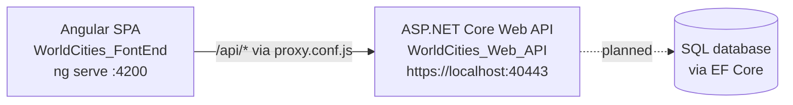

# World Cities App

A learning project that pairs an Angular single-page application with an ASP.NET Core Web API to browse world cities and countries. The intended stack also includes Entity Framework Core and a SQL database.

> **Status:** early stage. The front end has a home page with an Angular Material toolbar. The API has the `City` and `Country` entity models, but no `DbContext`, database or cities/countries endpoints yet. The only API endpoint is the template `WeatherForecast` sample.

## Features

- Angular 15 SPA with routing, Angular Material toolbar and a static home page
- ASP.NET Core 7 Web API with Swagger UI in Development
- EF Core entity models with data annotations:
  - `Country` (`Countries` table): `Id`, `Name`, `ISO2`, `ISO3`, indexed on `Name`, `ISO2` and `ISO3`, plus a collection of cities
  - `City` (`Cities` table): `Id`, `Name`, `Lat`, `Lon` (`decimal(7,4)`), `CountryId` foreign key, indexed on `Name`, `Lat` and `Lon`
- Angular dev-server proxy that forwards `api/` requests to the backend
- Visual Studio solution holding both projects (`.csproj` + `.esproj`)

## Tech stack

| Layer | Technology | Version |
| --- | --- | --- |
| Back end | .NET / ASP.NET Core (`net7.0`) | 7 |
| | Microsoft.EntityFrameworkCore | 6.0.0 |
| | Microsoft.AspNetCore.OpenApi | 7.0.5 |
| | Swashbuckle.AspNetCore | 6.4.0 |
| Front end | Angular (core, router, forms, animations) | 15.2.9 (`^15.2.0`) |
| | Angular Material / CDK | 15.2.9 |
| | Angular CLI | 15.2.8 |
| | TypeScript | 4.9.5 (`~4.9.4`) |
| | RxJS | 7.8.1 (`~7.8.0`) |
| Tests | Karma + Jasmine | 6.4 / 4.5 |

Versions in brackets are the ranges in `package.json`. The others are the versions locked in `package-lock.json`.

## Architecture



```
WorldCities.sln
├── WorldCities_Web_API/        ASP.NET Core Web API
│   ├── Controllers/            WeatherForecastController (template sample)
│   └── Data/Models/            City, Country entities
└── WorldCities_FontEnd/        Angular 15 SPA
    └── src/app/                home-component, nav-menu-component, routing
```

## API endpoints

| Method | Route | Description |
| --- | --- | --- |
| GET | `/WeatherForecast` | Template sample: 5 random weather forecasts |
| GET | `/swagger` | Swagger UI (Development only) |

The Angular proxy only forwards `api/` paths. The sample controller is mapped to `/WeatherForecast`, which has no `api/` prefix, so the front end does not call it.

## Prerequisites

- A .NET SDK that can target `net7.0`. The project builds with the .NET 7 SDK or newer. Newer SDKs show warning `NETSDK1138` because .NET 7 is out of support.
- To run the API, an ASP.NET Core 7 runtime, or roll-forward to a newer one (see below).
- Node.js and npm. Angular CLI 15 officially supports Node 14.20+, 16.13+ and 18.10+. `npm ci` and `ng build` also work on Node 22.
- A trusted ASP.NET Core HTTPS development certificate: `dotnet dev-certs https --trust`

## Configuration

- `WorldCities_Web_API/appsettings.json` only holds logging settings and `AllowedHosts`. No connection string is defined yet.
- API launch profiles (`Properties/launchSettings.json`): `https` on `https://localhost:40443` and `http://localhost:40080`.
- Front-end proxy (`WorldCities_FontEnd/src/proxy.conf.js`): `api/` goes to `https://localhost:40443`.
- `src/environments/environment.prod.ts` sets `baseUrl` to `https://localhost:40443`.

## Running locally

### Back end

```bash
cd WorldCities_Web_API
dotnet restore
dotnet run --launch-profile https
```

Swagger UI: `https://localhost:40443/swagger`. If only a newer ASP.NET Core runtime is installed, set `DOTNET_ROLL_FORWARD=Major` first.

### Front end

```bash
cd WorldCities_FontEnd
npm install
npm start
```

`npm start` first runs `aspnetcore-https.js`, which exports the ASP.NET Core development certificate. It then starts `ng serve` over HTTPS with that certificate, on `https://localhost:4200` by default. The `start` script uses Windows `%APPDATA%` paths. On macOS or Linux, run `npx ng serve` instead, or change the certificate paths.

You can also open `WorldCities.sln` in Visual Studio 2022 and start both projects together.

### Production build

```bash
cd WorldCities_FontEnd
npm run build   # output: dist/angularapp
```

## Tests

```bash
# Front-end unit tests (Karma + Jasmine, needs Chrome)
cd WorldCities_FontEnd
npm test
# single run in CI-style mode:
npx ng test --watch=false --browsers=ChromeHeadless
```

Four of the five generated specs currently fail. They do not import the Angular Material modules or declare the nav-menu component the templates use, and the `AppComponent` spec still expects the original CLI template. The back end has no test project yet.
